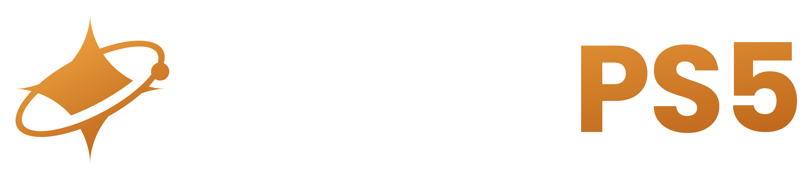

# NovaPS5

A modern Windows desktop library that installs, converts and launches PS5 game dumps using the
[AnyPS5](https://github.com/boykopovar/AnyPS5) relinker — **by Nova Crafted**.

Point it at a dump folder (or a `.zip` / `.rar` / `.7z`), and NovaPS5 unwraps the SELF containers,
relinks the executable, lays out the runtime, installs the game, then **launches it once to tell you
whether it works**. No command line, no manual tooling.



---

## Features

- **Installs every convertible dump.** Duplicate modules, both `sce_module/` and `sce_modules/`,
  leftover `*.bak*` files, symlinked or odd archive entries and `.rar` / `.7z` sources are all handled
  automatically — the installer never destroys a working install (stage-then-swap).
- **Preflight before install.** The eboot is trial-unwrapped ahead of time, so encrypted or truncated
  dumps are flagged with a plain reason *before* anything is copied; missing runtime libraries are
  predicted too.
- **Works / Not working verdict.** After installing, the game is launched once, watched for 10 seconds
  with a crash log, and marked **✓ Works** or **✗ Not working** with a readable reason
  (e.g. `crashed (0xC0000409 — stack buffer overrun / fail-fast)`). Verified games keep running.
- **Library scan.** Missed installs on disk are adopted, vanished folders are flagged — no restart needed.
- **Custom games folder.** Change it in Settings and every installed game is relocated safely.
- **Runtime updates.** The conversion runtime is fetched from AnyPS5 releases and refreshed
  automatically; Settings shows *Up to date* with an on-demand **Scan for updates**.
- **Python is bundled.** End users never install Python — the interpreter ships inside the app.

## Requirements

- Windows 10/11 (x64)
- That's it. The app bundles Python, downloads the AnyPS5 runtime on first launch, and installs
  per-user (no admin prompt).

## Using it

1. Run the installer and launch **NovaPS5** (first launch prepares the conversion runtime).
2. **Install game** → pick a dump folder or archive → review the compatibility report → **Install**.
3. When it finishes you get the launch-test verdict, then hit **Play**.

Games are installed into the folder shown under **Settings ▸ Storage** (changeable at any time).

## Building

```bash
npm install
npm run dev          # development
npm run dist         # Windows installer  -> release/NovaPS5-Setup-<version>.exe
npm run dist:dir     # unpacked app       -> release/win-unpacked/NovaPS5.exe
```

`npm run dist` first downloads the embeddable Python runtime (`npm run setup:python`) so the installed
app is self-contained, then packages `resources/tools` (relinker + libs) and the Python runtime next to
the executable.

> **Windows toolchain note:** electron-builder unpacks its `winCodeSign` tool cache with symbolic links,
> which Windows only permits in Developer Mode or from an elevated shell. `npm run dist` prepares that
> cache itself — the macOS-only payload that uses symlinks is excluded, since Windows never needs it —
> so the build runs from a normal terminal and still stamps the NovaPS5 icon, product name and version
> onto the exe and installer.

Icon/branding assets: `public/icon.png` (app icon) and `public/logo.png` (wordmark). Regenerate the
Windows icon after changing them with `powershell -ExecutionPolicy Bypass -File scripts/make-icon.ps1`.

## How an install works

```
validate → copy to staging → unwrap eboot (SELF → ELF) → unwrap modules → relink (AnyPS5)
        → build app0/ runtime layout → swap into place → launch test → Works / Not working
```

- Everything is prepared in `.staging-<id>-<ts>` and swapped in with an `.old` rollback, so a failure
  never leaves a broken install behind.
- `scripts/unwrap_self.py` (from AnyPS5) turns a decrypted SELF container into a clean ELF; the app
  runs it with the bundled Python.
- Conversion is local: nothing is uploaded, and no game content is downloaded.

## Project layout

| Path | Purpose |
| --- | --- |
| `src/main` | Electron main process: window, IPC, library, settings |
| `src/main/pipeline` | Conversion pipeline (`dump`, `compat`, `install`, `verify`, `relink`, `elf`) |
| `src/preload` | `contextBridge` API exposed to the renderer |
| `src/renderer` | React UI (library, detail, settings, install dialog, bootstrap) |
| `src/shared` | Types shared across processes |
| `scripts` | Runtime/python setup, icon generation, dist wrapper |
| `public` | Brand assets (`icon.png`, `logo.png`, `favicon.ico`) |

## Notes

- Use dumps of games you own. NovaPS5 is a local converter — it ships no game content and has no
  downloader.
- The conversion runtime (relinker + libraries) comes from the
  [AnyPS5 releases](https://github.com/boykopovar/AnyPS5/releases) and can be updated from Settings.
